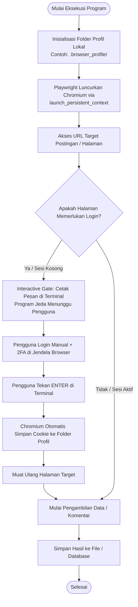

# Panduan Rancang Bangun: Persistent Browser Login & Interactive Login Gate (Playwright Python)

Dokumen ini berisi rancangan arsitektur, konsep kerja, dan kode template mandiri (*reusable blueprint*) untuk menerapkan sistem login browser persisten yang dapat digunakan kembali (*session reuse*) pada berbagai platform media sosial atau situs web modern (TikTok, Instagram, LinkedIn, Twitter/X, dll.).

---

## 1. Latar Belakang & Masalah (*Problem Statement*)

Dalam otomasi dan *web scraping* modern, situs web menerapkan proteksi ketat:
1. **Login Wall / Guest Barrier**: Pengguna yang belum masuk (*guest*) hanya dapat melihat sebagian kecil konten atau dibatasi scroll komentarnya.
2. **Kegagalan Otomasi Login Penuh (*Automated Form Fill*)**: Menggunakan bot untuk mengetik username dan password otomatis rentan gagal karena langsung memicu deteksi bot, teka-teki CAPTCHA, SMS OTP, atau verifikasi 2FA.
3. **Sesi Ephemeral / Hilang**: Secara *default*, peramban otomasi (`browser.new_context()`) berjalan dalam mode *Incognito* sementara. Begitu browser ditutup, seluruh *cookie* dan token sesi terhapus sehingga program harus login ulang dari nol setiap kali dijalankan.

---

## 2. Solusi Desain: *Persistent Context* + *Human-in-the-Loop*

Pendekatan terbaik yang menggabungkan keamanan akun dan keandalan otomasi adalah:
1. **Persistent Browser Context**: Mengarahkan peramban Chromium untuk menggunakan folder lokal permanen (`user_data_dir`) sebagai penyimpanan *cookies*, *localStorage*, dan *cache*, persis seperti profil Google Chrome di komputer Anda.
2. **Human-in-the-Loop Interactive Gate**: Jika halaman membutuhkan login atau verifikasi keamanan, peramban dibuka dalam mode visual (*headed*) dan program berhenti sementara (*pause*) di terminal, memberikan waktu bagi pengguna manusia untuk login dan menyelesaikan 2FA secara manual.
3. **Session Reuse (Otomatis)**: Setelah login manual selesai satu kali, sesi tersimpan permanen di folder lokal. Pada eksekusi berikutnya, program langsung berjalan sebagai akun terotentikasi tanpa meminta login lagi.

---

## 3. Diagram Alur Sistem (*Architecture Flow*)



---

## 4. Tiga Pilar Komponen Utama

### A. Persistent Browser Context (`launch_persistent_context`)
Perbedaan utama antara sesi sementara (*incognito*) dan sesi permanen:
- **Incognito (Standar)**:
  ```python
  browser = pw.chromium.launch()
  context = browser.new_context() # Sesi hilang saat browser.close()
  ```
- **Persistent (Direkomendasikan)**:
  ```python
  context = pw.chromium.launch_persistent_context(
      user_data_dir=".browser_profile/", # Folder disk lokal
      headless=False,
      ...
  )
  ```
Folder `.browser_profile/` akan berisi basis data SQLite internal Chromium yang menyimpan *HTTP Cookies* (seperti `sessionid`, `csrftoken`), *LocalStorage*, dan *IndexedDB*.

### B. Anti-Automation & Stealth Arguments
Platform media sosial mendeteksi bot melalui variabel JavaScript `navigator.webdriver`. Untuk menonaktifkannya:
```python
args = [
    "--disable-blink-features=AutomationControlled", # Menonaktifkan flag bot Chromium
    "--start-maximized",
]
```
Sertakan juga User-Agent browser desktop asli dan pengaturan *locale* lokal (misalnya `id-ID`).

### C. Interactive Login Gate
Fungsi pemeriksa barrier yang fleksibel:
```python
def is_login_required(page) -> bool:
    current_url = (page.url or "").lower()
    if any(k in current_url for k in ["login", "signin", "accounts/login"]):
        return True
    return page.evaluate("() => !!document.querySelector('input[type=\"password\"]')")
```

---

## 5. Template Kode Mandiri (*Reusable Script*)

Berikut adalah kode lengkap siap pakai yang dapat Anda simpan sebagai `persistent_session_scraper.py` dan disesuaikan untuk kebutuhan proyek Anda:

```python
"""
persistent_session_scraper.py
Template Reusable: Persistent Session & Interactive Login Gate menggunakan Playwright.
Dapat digunakan untuk Instagram, TikTok, LinkedIn, Twitter/X, Facebook, dll.
"""

import time
from pathlib import Path
from typing import Callable
from playwright.sync_api import sync_playwright


class PersistentSessionScraper:
    def __init__(self, profile_dir: str = ".browser_profile", headless: bool = False):
        """
        :param profile_dir: Nama folder lokal tempat cookie & sesi disimpan.
        :param headless: False agar jendela browser tampil untuk login manual.
        """
        self.profile_dir = Path(profile_dir).resolve()
        self.profile_dir.mkdir(parents=True, exist_ok=True)
        self.headless = headless

    def get_browser_options(self) -> dict:
        """Konfigurasi browser persisten dengan proteksi anti-deteksi bot."""
        return {
            "user_data_dir": str(self.profile_dir),
            "headless": self.headless,
            "viewport": {"width": 1280, "height": 800},
            "locale": "id-ID",
            "user_agent": (
                "Mozilla/5.0 (Windows NT 10.0; Win64; x64) "
                "AppleWebKit/537.36 (KHTML, like Gecko) "
                "Chrome/124.0.0.0 Safari/537.36"
            ),
            "args": [
                "--disable-blink-features=AutomationControlled",
                "--start-maximized",
            ],
        }

    def is_login_barrier_present(self, page) -> bool:
        """Deteksi apakah halaman saat ini adalah halaman login atau terhalang modal login."""
        current_url = (page.url or "").lower()
        if any(keyword in current_url for keyword in ["login", "signin", "accounts/login"]):
            return True

        try:
            # Periksa apakah ada kolom input password atau teks ajakan login
            has_barrier = page.evaluate(
                """
                () => {
                    const passInput = document.querySelector('input[type="password"]');
                    if (passInput) return true;

                    const bodyText = document.body ? document.body.innerText : '';
                    const keywords = [
                        "Masuk untuk melihat", "Log in to see", 
                        "Masuk ke Instagram", "Log in to TikTok",
                        "Sign in to Twitter", "Sign in to LinkedIn"
                    ];
                    return keywords.some(k => bodyText.includes(k));
                }
                """
            )
            return bool(has_barrier)
        except Exception:
            return False

    def wait_for_user_login(self, page, target_url: str, input_fn: Callable[[str], str] = input) -> bool:
        """Interactive Gate: Menahan proses terminal dan menunggu pengguna login di browser."""
        print("\n" + "=" * 65)
        print("                 [LOGIN DIPERLUKAN]")
        print("=" * 65)
        print("Situs web membatasi akses untuk akun yang belum terautentikasi.")
        print("Jendela browser saat ini sedang terbuka di monitor Anda.")
        print("")
        print("Panduan Langkah:")
        print("1. Silakan login ke akun Anda di browser yang terbuka.")
        print("2. Selesaikan verifikasi (2FA / OTP / Captcha) jika diminta.")
        print(f"3. Sesi login akan otomatis tersimpan di folder: {self.profile_dir.name}/")
        print("4. Setelah berhasil masuk dan halaman target terbuka kembali,")
        print("   tekan tombol [ENTER] pada terminal ini untuk melanjutkan.")
        print("=" * 65)

        try:
            input_fn("\nTekan [ENTER] setelah Anda selesai login di browser... ")
        except (KeyboardInterrupt, EOFError):
            print("\n[INFO] Proses login dibatalkan oleh pengguna.")
            return False

        # Reload halaman target jika sebelumnya berada di rute login
        time.sleep(2.0)
        try:
            if "login" in (page.url or "").lower():
                page.goto(target_url, timeout=30000, wait_until="domcontentloaded")
                time.sleep(2.0)
        except Exception:
            pass

        return True

    def execute(self, target_url: str, custom_scrape_fn: Callable[[any], None] = None):
        """Membuka sesi terotentikasi dan menjalankan logika ekstraksi data."""
        with sync_playwright() as pw:
            # Buka browser dengan profil lokal persisten
            context = pw.chromium.launch_persistent_context(**self.get_browser_options())
            page = context.pages[0] if context.pages else context.new_page()

            try:
                print(f"[INFO] Membuka URL: {target_url}")
                page.goto(target_url, timeout=45000, wait_until="domcontentloaded")
                time.sleep(3.0)

                # Pengecekan barrier login
                if self.is_login_barrier_present(page):
                    success = self.wait_for_user_login(page, target_url)
                    if not success:
                        print("[ERROR] Login tidak diselesaikan. Operasi dibatalkan.")
                        return

                print("\n[SUKSES] Sesi terotentikasi aktif!")
                print(f"[INFO] Judul Halaman: {page.title()}")

                # Jalankan fungsi scraping kustom pengguna jika disediakan
                if custom_scrape_fn:
                    custom_scrape_fn(page)
                else:
                    print("[INFO] Tidak ada fungsi scraping kustom. Menutup browser...")

            finally:
                # Menutup context akan otomatis menulis seluruh cookie terbaru ke disk
                context.close()
                print(f"[INFO] Sesi browser berhasil diperbarui di folder '{self.profile_dir.name}'.")


# --- CONTOH PEMAKAIAN ---
if __name__ == "__main__":
    def my_scraper_logic(page):
        # Contoh: Ekstraksi teks atau scroll komentar
        print("[SCRAPER] Mengambil informasi dari halaman...")
        # Lakukan scroll atau ekstraksi di sini:
        # page.mouse.wheel(0, 1000)
        time.sleep(2.0)
        print("[SCRAPER] Selesai mengambil data!")

    scraper = PersistentSessionScraper(
        profile_dir=".my_social_session", # Folder sesi lokal
        headless=False                     # Gunakan False agar browser terlihat
    )

    # Masukkan URL target postingan
    sample_url = "https://www.instagram.com/p/ContohPostingan/"
    scraper.execute(target_url=sample_url, custom_scrape_fn=my_scraper_logic)
```

---

## 6. Praktik Terbaik & Tips Keamanan (*Best Practices*)

1. **Tambahkan Folder Sesi ke `.gitignore`**:
   Folder profil (`.browser_profile/` atau `.my_social_session/`) berisi berkas *cookie* otentikasi akun Anda. **Jangan pernah mengunggah folder ini ke repository publik (GitHub/GitLab)**:
   ```gitignore
   # .gitignore
   .browser_profile/
   .my_social_session/
   *.session
   ```
2. **Dukungan Multi-Akun**:
   Jika Anda membutuhkan rotasi akun atau beberapa platform yang berbeda, pisahkan direktori profilnya:
   - Instagram Akun 1: `profile_dir=".profile_ig_01"`
   - TikTok Akun Riset: `profile_dir=".profile_tiktok_research"`
   - LinkedIn: `profile_dir=".profile_linkedin"`
3. **Mengatasi Sesi Kedaluwarsa (*Session Expiry*)**:
   Jika *cookie* kedaluwarsa setelah beberapa minggu/bulan, fungsi `is_login_barrier_present` akan otomatis mendeteksinya kembali dan memicu `wait_for_user_login`, sehingga pengguna cukup login ulang satu kali untuk memperbarui masa aktif *cookie*.
4. **Pencegahan Deteksi Pola Bot (*Human-like Behavior*)**:
   - Selalu beri jeda alami antar-halaman (`time.sleep(2.0)` hingga `time.sleep(4.0)`).
   - Hindari *request* simultan yang tidak wajar.
   - Pindahkan kursor mouse secara fisik (`page.mouse.move()` atau `locator.hover()`) sebelum melakukan scroll atau klik tombol.

