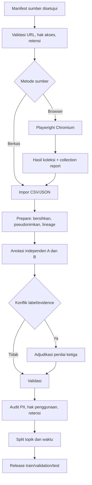

# PRODUCT REQUIREMENTS DOCUMENT

# Pengumpulan dan Penyiapan Dataset REDAM.id

**Nama produk:** REDAM.id Dataset Collection Pipeline  
**Jenis dokumen:** Product Requirements Document khusus pengumpulan data penelitian  
**Versi:** 1.0.0  
**Tanggal:** 6 November 2026  
**Status:** Baseline implementasi dan validasi dataset  
**Owner utama:** Data Science REDAM.id  
**Owner kolektor dan keamanan:** Backend/Infrastructure REDAM.id  
**Dokumen acuan:** `REDAM_DATASET.md`, `REDAM_ANNOTATION_GUIDE.md`, PRD dan SCRAPING_SPEC proyek REDAM.id

> PRD ini mengatur pipeline offline untuk mengumpulkan, membersihkan, menganotasi, memvalidasi, dan merilis dataset REDAM.id. PRD aplikasi REDAM.id tetap menjadi sumber kebenaran untuk perilaku produk web. Perubahan kontrak aplikasi, retensi, platform aktif, atau metode akses harus diselaraskan dengan owner proyek.

---

## 1. Ringkasan Eksekutif

Pipeline dataset REDAM.id membantu peneliti mengumpulkan komentar dari postingan Instagram dan TikTok, menyimpan provenance, meminimalkan identitas akun, menyiapkan anotasi dua penilai, dan menghasilkan dataset `train`, `validation`, serta `test` yang dapat digunakan untuk penelitian model indikasi koordinasi.

Unit utama dataset adalah **satu kasus/postingan beserta kumpulan komentarnya**. Label menjelaskan pola yang teramati pada sampel, bukan identitas, pekerjaan, afiliasi, pembayaran, atau niat pemilik akun. Sistem tidak memberi label individu sebagai buzzer.

Pengumpulan browser memakai Playwright Python dan Chromium. Pada penggunaan CLI lokal, browser harus dapat ditampilkan agar operator dapat melihat navigasi dan kegagalan akses. Browser tidak digunakan untuk melewati login, CAPTCHA, akun privat, rate limit, atau perlindungan platform.

Dataset hanya berstatus `ready_for_training=true` setelah sumber dan hak penggunaan diverifikasi, dua anotator menyelesaikan penilaian, konflik diadjudikasi, agreement memenuhi ambang, audit PII lulus, dan split bebas kebocoran yang terdeteksi.

---

## 2. Latar Belakang

REDAM.id membutuhkan data untuk menguji semantic similarity, clustering narasi, pengulangan sosial, pola temporal, pengulangan akun dalam satu kasus, confidence, dan mekanisme `insufficient_data`. Data komentar biasa belum langsung menjadi dataset latih karena:

1. Struktur dan kelengkapan komentar berbeda antarplatform dan dapat berubah.
2. Teks identik dari record berbeda merupakan sinyal sosial dan tidak boleh dianggap duplikasi teknis.
3. Timestamp, akun, likes, dan jumlah total komentar sering tidak tersedia.
4. Data publik tetap dapat memuat informasi pribadi.
5. Ground truth koordinasi tidak dapat disimpulkan dari viralitas, similarity, atau orientasi opini.
6. Pembagian acak per komentar menyebabkan kebocoran topik dan postingan.

Pipeline diperlukan agar setiap transformasi, pengecualian, label, dan keputusan rilis dapat diaudit.

---

## 3. Tujuan dan Indikator Keberhasilan

### 3.1 Tujuan

- Mengumpulkan komentar yang benar-benar dapat diakses dari URL yang telah disetujui.
- Menyediakan impor CSV/JSON berizin ketika akses browser tidak tersedia.
- Menjaga provenance `LIVE`, `DEMO`, dan kondisi `PARTIAL`.
- Menghasilkan teks bersih tanpa menghilangkan slang, emoji, tanda baca, dan pengulangan penting.
- Membuat pseudonim akun yang hanya stabil dalam satu kasus.
- Menyediakan proses anotasi independen oleh dua orang dan adjudikasi konflik.
- Menghasilkan rilis dataset kasus dalam JSONL dengan split topik dan waktu.
- Mencegah rilis ketika hak penggunaan, retensi, anotasi, atau audit belum memenuhi syarat.

### 3.2 KPI pilot

| ID | Indikator | Target |
|---|---|---:|
| K01 | URL berbahaya ditolak sebelum browser dibuka | 100% kasus uji |
| K02 | Record hasil koleksi mempunyai provenance | 100% |
| K03 | Username/cookie/token tersimpan di paket dataset | 0 temuan |
| K04 | Kasus dengan kurang dari 20 komentar menerbitkan label yang dapat dinilai | 0 kasus; wajib `not_assessable` |
| K05 | Weighted kappa label kasus | minimal 0,70 |
| K06 | Kappa evidence yang muncul | minimal 0,60 per evidence |
| K07 | Evidence mengacu pada `comment_ref` nyata | 100% |
| K08 | Duplikasi exact/near-duplicate yang terdeteksi lintas split | 0 saat rilis |
| K09 | Paket rilis memiliki checksum dan dataset card | 100% |
| K10 | Alur demo dapat diulang | 5 dari 5 eksekusi |

KPI tersebut adalah quality gate pipeline, bukan klaim akurasi deteksi buzzer dunia nyata.

---

## 4. Pengguna dan Peran

| Peran | Tanggung jawab |
|---|---|
| Operator koleksi | Menyiapkan manifest, menjalankan browser, memeriksa status dan menyimpan referensi hak akses |
| Data engineer/data scientist | Menyiapkan paket, memeriksa exclusion, lineage, distribusi dan split |
| Anotator A dan B | Menilai kasus secara independen tanpa melihat skor model atau jawaban satu sama lain |
| Adjudikator | Menyelesaikan perbedaan label/evidence tanpa menimpa anotasi asli |
| Reviewer data | Memeriksa PII, provenance, hak penggunaan dan retensi sebelum rilis |
| Model developer | Menggunakan artefak rilis sesuai task dan batas dataset card |

Satu orang tidak boleh bertindak sebagai A, B, dan adjudikator pada kasus yang sama.

---

## 5. Ruang Lingkup

### 5.1 Termasuk

- Menu terminal REDAM.id.
- Fixture `DEMO` sintetis.
- Koleksi browser best-effort menggunakan Playwright.
- Impor berkas CSV dan array JSON.
- Validasi manifest dan URL.
- Normalisasi, redaksi pola PII, pseudonimisasi dan deduplikasi teknis.
- Template anotasi kasus, pasangan komentar, dan cluster.
- Validasi label kasus dan agreement.
- Audit manual PII/hak penggunaan.
- Split berbasis grup topik dan waktu.
- Ekspor JSONL dan dokumentasi rilis.

### 5.2 Di luar cakupan versi ini

- Pelacakan identitas akun lintas postingan atau lintas platform.
- Login otomatis, penyimpanan kredensial, CAPTCHA solving, proxy rotasi, atau bypass anti-bot.
- Pengambilan akun privat dan pesan pribadi.
- Scraping berkelanjutan 24/7 atau crawling akun massal.
- Pengunduhan video, audio, gambar, screenshot, dan raw HTML secara default.
- Pelabelan akun sebagai buzzer, bot, propaganda berbayar, atau afiliasi tertentu.
- Auto-label ground truth dari risk score, clustering, atau LLM.
- Rilis gold pasangan/cluster sebelum validator dan adjudikasi khusus tersedia.
- Klaim representasi opini seluruh populasi platform.

---

## 6. Alur Utama



### 6.1 Alur melalui menu

Operator menjalankan:

```powershell
cd D:\WEBKU\NLP
py -3.11 main.py --redam
```

Menu yang tersedia:

1. Membuat 12 kasus `DEMO` sintetis dengan 509 komentar.
2. Mengumpulkan data browser dari manifest.
3. Mengimpor/membersihkan data dan membuat template anotasi.
4. Menampilkan lokasi artefak anotasi dan pedoman.
5. Memvalidasi paket dan hasil anotasi.
6. Merilis dataset train/validation/test.
7. Menampilkan ringkasan paket lokal.
8. Menampilkan panduan alur.

Folder keluaran selalu baru dan bertimestamp. Pipeline tidak menimpa RAW atau paket sebelumnya.

---

## 7. Persyaratan Fungsional

### FR-01 — Navigasi menu

- Menu REDAM dapat dibuka dari menu utama pilihan `8` atau `main.py --redam`.
- Semua operasi menyediakan pilihan batal yang aman.
- Error input ditampilkan dalam Bahasa Indonesia tanpa stack trace atau secret.
- Menu menampilkan dengan jelas apakah hasil masih menunggu anotasi atau sudah siap latih.

### FR-02 — Manifest penelitian

Setiap kasus wajib memuat:

- `case_id` unik;
- `platform`: `instagram` atau `tiktok`;
- `topic_group`;
- `period` dalam `YYYY-MM-DD`;
- `source_type`: `live` atau `demo`;
- `origin`: `research_collection`, `licensed`, atau `synthetic`;
- `rights_reference`;
- `retention_until` berupa timestamp UTC yang masih berlaku.

Kasus `live` hasil impor wajib memiliki `collected_at` terverifikasi. Kasus sintetis wajib memakai `source_type=demo`.

Untuk koleksi browser, manifest juga wajib memuat:

- `url` permalink postingan;
- `access_reviewed_by`;
- `adapter_version`;
- `locators.item`, `locators.text`, dan `locators.id_attribute`;
- locator opsional untuk akun, waktu, access barrier, dan area scroll.

### FR-03 — Validasi URL

- Hanya URL HTTPS pada host exact-match platform yang diterima.
- Instagram mendukung permalink `/p/{shortcode}` dan `/reel/{shortcode}`.
- TikTok mendukung permalink `/@{username}/video/{id}`.
- Query dan fragment pelacakan dihapus dari URL kanonis.
- URL dengan kredensial, port asing, hostname palsu, atau IP nonpublik ditolak.
- DNS dan subrequest browser diperiksa untuk mencegah akses jaringan privat.

### FR-04 — Browser Playwright

- CLI lokal membuka Chromium dalam mode terlihat agar operator dapat mengamati proses.
- Mode headless boleh tersedia sebagai konfigurasi eksplisit untuk CI/worker setelah adapter lolos uji.
- Browser memakai context baru per kasus dan tidak menyimpan profil login.
- Media, gambar, dan font boleh diblokir untuk mengurangi beban.
- Request dibatasi pada host platform yang diizinkan.
- Browser berhenti saat login barrier, CAPTCHA, postingan tidak tersedia, selector rusak, timeout, atau pembatalan.
- Browser context selalu ditutup pada jalur sukses maupun gagal.

**Gap implementasi 1.0:** kolektor saat ini menetapkan `headless=True`; perubahan ke mode terlihat/default yang dapat dikonfigurasi diperlukan untuk memenuhi requirement CLI lokal ini.

### FR-05 — Batas pengumpulan

- Maksimal 200 komentar valid per kasus.
- Maksimal 20 putaran scroll.
- Berhenti setelah 3 putaran tanpa record baru.
- Timeout navigasi 30 detik dan timeout locator 3 detik.
- Target durasi koleksi sekitar 90 detik per kasus, diperiksa antariterasi.
- Jika batas tercapai sebelum akhir komentar dapat dibuktikan, `is_partial=true`.
- Tiga scroll stagnan tidak boleh diklaim sebagai bukti seluruh komentar telah selesai dimuat.

### FR-06 — Ekstraksi komentar

Field minimum hasil koleksi:

| Field | Aturan |
|---|---|
| `comment_id` | Pseudonim ID sumber; tidak boleh berisi identifier mentah |
| `text` | Teks komentar; kosong tidak disimpan |
| `created_at` | ISO 8601 UTC jika dapat diverifikasi; selain itu `null` |
| `account` | Pseudonim akun dalam satu kasus; selain itu `null` |
| `likes_count` | Integer nonnegatif; selain itu `null` |

`collected_at` tidak boleh digunakan sebagai pengganti `created_at`. Username, URL profil, cookie, token, password, raw HTML, dan screenshot tidak disimpan.

### FR-07 — Deduplikasi

- Jika ID sumber stabil tersedia, pengamatan ulang ID yang sama dengan teks sama dikeluarkan sebagai `technical_duplicate`.
- ID sama dengan teks berbeda memblokir prepare dan membutuhkan review sumber.
- Dua ID berbeda dengan teks identik tetap disimpan karena merupakan sinyal pengulangan sosial.
- Kesamaan teks saja tidak digunakan untuk menghapus record sebelum analisis.

### FR-08 — Pembersihan dan minimisasi

- Teks asli tidak ditulis ulang pada sumber.
- Teks komputasi memakai Unicode NFC dan whitespace tunggal.
- URL, email, telepon, dan mention diganti token.
- Emoji, bahasa campuran, slang, kapitalisasi, tanda baca, dan huruf berulang dipertahankan.
- Teks dibatasi 2.000 karakter dan diberi `truncated=true` jika dipotong.
- Semua record yang dikeluarkan memiliki `exclude_reason`.
- Pseudonim menggunakan HMAC dengan secret minimal 32 karakter yang tidak disimpan ke repository.
- Pseudonim akun berbeda antar-kasus meskipun username sumber sama.

### FR-09 — Provenance dan kualitas

Setiap kasus menyimpan:

- platform, origin, source type dan source post pseudonim;
- adapter version dan collected time;
- `items_seen`, `comments_collected`, `comments_valid`, `comments_analyzed`;
- total komentar platform jika dapat dipercaya;
- partial status, quality label dan limitations;
- checksum sumber, referensi hak penggunaan dan tenggat retensi.

Invariant:

```text
0 <= comments_analyzed <= comments_valid <= comments_collected <= items_seen
```

Nilai tidak diketahui memakai `null`, bukan nol atau data rekaan.

### FR-10 — Anotasi

- Dua anotator menilai setiap kasus secara independen.
- Anotator tidak melihat risk score, output model, atau penilaian anotator lain.
- Label kasus: `none`, `uncertain`, `strong`, `not_assessable`.
- Kasus dengan komentar valid kurang dari 20 wajib `not_assessable`.
- `uncertain` dan `strong` wajib mempunyai evidence label serta `comment_ref` nyata.
- `strong` membutuhkan minimal dua jenis sinyal pendukung dan dua referensi komentar.
- Konflik label atau evidence wajib diselesaikan adjudikator ketiga.
- Anotasi asli tidak ditimpa setelah adjudikasi.

Evidence yang diizinkan:

- `exact_text_repetition`;
- `semantic_concentration`;
- `temporal_burst`;
- `within_case_account_repetition`;
- `community_slogan`;
- `legitimate_criticism`;
- `insufficient_context`;
- `missing_temporal_data`;
- `missing_account_data`.

### FR-11 — Validasi anotasi

- Weighted kappa untuk label ordinal `none/uncertain/strong` minimal 0,70.
- Kappa binary setiap evidence yang muncul minimal 0,60.
- Agreement yang tidak terdefinisi tidak dianggap sempurna.
- Evidence temporal membutuhkan minimal dua timestamp berbeda yang valid.
- Evidence pengulangan akun membutuhkan account pseudonim sama pada minimal dua record evidence.
- Catatan alasan wajib diisi setiap anotator dan adjudikator.

### FR-12 — Audit rilis

Reviewer membuat `audit.json` dari `audit.template.json` dan mengisi:

- identitas/kode reviewer;
- `pii_review_passed=true`;
- `rights_review_passed=true`;
- checksum paket yang diaudit;
- catatan audit.

Regex redaksi bukan pengganti audit manual. Audit harus dilakukan terhadap paket yang checksum-nya sama dengan paket yang dirilis.

### FR-13 — Split dan kebocoran

- Rilis membutuhkan minimal tujuh `topic_group` independen.
- Target split mendekati 70/15/15 berdasarkan grup topik.
- Validation dan test menggunakan periode lebih baru daripada train.
- Satu kasus tidak boleh tersebar ke beberapa split.
- Exact duplicate dan near-duplicate karakter dengan threshold 0,90 untuk teks minimal 20 karakter tidak boleh melintasi split.
- Konflik temporal atau kebocoran memblokir rilis; pipeline tidak memindahkan kasus diam-diam.
- Review manual tetap diperlukan untuk parafrasa semantik lintas split.

### FR-14 — Rilis siap latih

Rilis menghasilkan:

- `train.jsonl`;
- `validation.jsonl`;
- `test.jsonl`;
- `split_manifest.json`;
- `quality_report.json`;
- `label_map.json`;
- `dataset_card.md`;
- `audit.json`;
- `checksums.json`.

Setiap baris JSONL berisi satu `case`, daftar `comments`, dan satu label `gold`. Label kasus tidak boleh disalin menjadi label setiap komentar.

Paket sintetis tidak dapat dirilis sebagai dataset riset. Paket sintetis tetap dapat dipakai untuk demo dan uji alur.

---

## 8. Kontrak Antarmuka CLI

### 8.1 Entry point

```powershell
py -3.11 main.py --redam
py -3.11 -m src.redam
```

Subcommand untuk otomasi:

```powershell
py -3.11 -m src.redam demo --out <folder-baru>
py -3.11 -m src.redam collect --manifest <manifest.json> --out <folder-baru>
py -3.11 -m src.redam prepare --manifest <manifest.json> --out <folder-baru>
py -3.11 -m src.redam validate --package <folder-paket>
py -3.11 -m src.redam release --package <folder-paket> --audit <audit.json> --out <folder-baru>
```

### 8.2 Kode hasil

- `0`: operasi berhasil atau menu ditutup dengan aman.
- `2`: input, anotasi, audit, atau rilis belum valid.
- Folder yang sudah ada tidak ditimpa.
- Error tidak boleh mencetak secret, cookie, stack trace, atau konten pribadi mentah.

### 8.3 Status koleksi

| Status | Makna | Tindakan operator |
|---|---|---|
| `partial` | Data tersedia tetapi cakupan tidak lengkap | Lanjutkan dengan limitation |
| `timeout_partial` | Data parsial tersedia sebelum timeout | Review jumlah dan kualitas |
| `ACCESS_RESTRICTED` | Login/CAPTCHA/pembatasan ditemukan | Hentikan; gunakan sumber berizin lain |
| `SCRAPER_CHANGED` | Locator/ID komentar tidak cocok | Review dan versi ulang adapter |
| `COLLECTION_ERROR_*` | Operasi browser gagal | Review lingkungan dan fixture |

Status gagal tidak boleh diganti menjadi data demo dalam job yang sama.

---

## 9. Kebutuhan Nonfungsional

### 9.1 Reproducibility

- Manifest, versi adapter, schema, label map, lineage, parameter split, dan checksum disimpan.
- Secret yang sama diperlukan untuk mereproduksi pseudonim dari sumber yang sama, tetapi secret tidak masuk artefak.
- Setiap output memakai folder baru agar riwayat tidak tertimpa.

### 9.2 Keamanan

- Validasi URL dan DNS dilakukan sebelum browser dan pada subrequest.
- Browser memakai context terisolasi dan selalu ditutup.
- Komentar diperlakukan sebagai data tidak tepercaya.
- Formula spreadsheet tidak dieksekusi; file anotasi diimpor sebagai teks.
- Artifact debug berisi halaman/screenshot tidak dibuat secara default.

### 9.3 Privasi

- Username mentah tidak masuk paket.
- Pseudonim tidak dianggap anonimisasi sempurna.
- Operator bertanggung jawab menghapus sumber, paket, rilis dan backup saat `retention_until` berakhir.
- Pipeline memblokir rilis setelah retensi berakhir, tetapi tidak melakukan penghapusan otomatis.

### 9.4 Skalabilitas

- Pilot ditargetkan sampai sekitar 8.000 komentar dan 120 kasus.
- Pemeriksaan kebocoran berpasangan saat ini cocok untuk pilot.
- Ekspansi besar memerlukan candidate index/ANN agar pemeriksaan near-duplicate tidak bersifat kuadratik.

### 9.5 Observability

Per koleksi catat tanpa PII:

- case ID;
- platform dan adapter version;
- waktu mulai/selesai;
- status;
- jumlah record;
- partial dan limitation;
- kategori error aman.

---

## 10. Data Demo dan Data Riset

| Aspek | DEMO | LIVE/Riset |
|---|---|---|
| Tujuan | Uji alur dan presentasi | Evaluasi/pengembangan model |
| Sumber | Sintetis buatan proyek | Koleksi penelitian atau dataset berizin |
| Label UI/provenance | `demo` | `live` dengan origin terkait |
| Boleh diklaim sebagai data nyata | Tidak | Hanya sesuai provenance dan batas sumber |
| Boleh dirilis sebagai dataset riset | Tidak | Ya, setelah seluruh gate lulus |

Generator versi awal membuat 12 kasus dan 509 komentar sintetis. Generator tidak mengisi label manusia dan tidak menghasilkan klaim akurasi.

---

## 11. Strategi Sampling Dataset Riset

Target awal adalah sekitar 8.000 komentar valid dari sekitar 120 postingan:

- 80 kasus Instagram pada fase pertama;
- 40 kasus TikTok setelah adapter dan hak akses tervalidasi;
- minimal 30% kasus kontrol yang mencakup percakapan organik, kritik sah, dan slogan komunitas;
- kasus dipilih berdasarkan topik, periode, dan metode sampling yang dicatat;
- kasus indikasi dan kontrol tidak ditentukan dari dukungan/penolakan politik, agama, atau identitas sensitif;
- kasus di bawah 20 komentar tetap dipertahankan untuk menguji abstention, tetapi tidak digunakan sebagai contoh skor numerik.

Distribusi target bukan estimasi prevalensi buzzer pada platform.

---

## 12. Test Plan dan Acceptance Criteria

### 12.1 Menu dan file

- Menu utama menampilkan pilihan REDAM.
- `--redam` membuka menu langsung.
- Ctrl+C/EOF keluar aman.
- Path kosong/default dan pilihan batal bekerja.
- Folder yang sudah ada tidak ditimpa.
- Paket lokal dapat dipilih dengan nomor.

### 12.2 Browser dan keamanan

- URL Instagram/TikTok valid diterima dan dikanonisasi.
- HTTP, localhost, private IP, host palsu, port asing, URL dengan credential ditolak.
- Browser terlihat pada mode CLI lokal.
- Headless hanya aktif ketika dipilih eksplisit.
- Login/CAPTCHA menghasilkan `ACCESS_RESTRICTED`.
- Selector tanpa ID stabil menghasilkan `SCRAPER_CHANGED`.
- Browser context tertutup setelah error.
- Tidak ada username/cookie/token di output.

### 12.3 Transformasi

- Emoji dan bahasa campuran dipertahankan.
- URL/email/telepon/mention disamarkan.
- Timestamp relatif atau tanpa timezone menjadi `null`.
- Duplikasi ID sama dikeluarkan sekali.
- Teks identik dari ID berbeda tetap disimpan.
- ID sama dengan teks berbeda memblokir prepare.
- Teks lebih dari 2.000 karakter ditandai truncated.
- RAW sumber tidak berubah setelah prepare.

### 12.4 Anotasi dan rilis

- Paket baru gagal validasi karena label belum lengkap.
- Dua anotator wajib untuk semua kasus.
- Konflik tanpa adjudikasi memblokir rilis.
- `strong` tanpa dua evidence pendukung ditolak.
- Kasus kurang dari 20 komentar selain `not_assessable` ditolak.
- Kappa di bawah ambang memblokir rilis.
- Audit dengan checksum berbeda ditolak.
- Paket sintetis ditolak sebagai rilis riset.
- Kurang dari tujuh grup topik ditolak.
- Periode overlap dan near-duplicate lintas split ditolak.
- Rilis valid menghasilkan tiga JSONL, dataset card, quality report dan checksum.

### 12.5 Definition of Done

Fitur pengumpulan dataset dinyatakan siap pilot ketika:

1. Menu dan subcommand berjalan pada Python 3.11+.
2. Playwright Chromium terpasang dan mode browser lokal terlihat berfungsi pada fixture/halaman uji.
3. Minimal satu adapter platform lolos fixture test dan pengujian live yang disetujui.
4. Koleksi gagal dengan jujur saat akses dibatasi.
5. Paket demo dapat dibuat, diproses, dan divalidasi berulang.
6. Dataset riset memiliki provenance dan hak penggunaan yang direview.
7. Dua anotator dan adjudikator menyelesaikan workflow.
8. Seluruh quality gate dan test kritis lulus.
9. Rilis memiliki dataset card, audit, split dan checksum.
10. Tidak ada klaim akun buzzer atau akurasi dunia nyata dari fixture sintetis.

---

## 13. Risiko dan Mitigasi

| Risiko | Dampak | Mitigasi |
|---|---|---|
| DOM platform berubah | Parser gagal | Locator berversi, fixture dan status `SCRAPER_CHANGED` |
| Platform meminta login/CAPTCHA | Koleksi gagal | Hentikan, catat `ACCESS_RESTRICTED`, gunakan impor berizin |
| Sampel tidak lengkap | Kesimpulan berlebihan | `is_partial`, limitations dan quality label |
| Timestamp/account tidak tersedia | Sinyal tidak dapat dinilai | Gunakan `null` dan evidence missing data |
| Komentar identik organik dianggap koordinasi | False positive | Kontrol komunitas/kritik, dua anotator, label uncertain |
| PII lolos regex | Kebocoran data | Audit manusia sebelum rilis |
| Topik bocor antar split | Evaluasi terlalu optimistis | Split grup/waktu dan pemeriksaan near-duplicate |
| Retensi kedaluwarsa | Pelanggaran kebijakan | Blokir rilis dan penghapusan operasional |
| Secret hilang/berubah | Pseudonim tidak reproducible | Pengelolaan secret di luar repository |
| Browser terlihat disalahartikan sebagai izin akses | Risiko kebijakan | Manifest hak akses dan reviewer wajib |

---

## 14. Status Implementasi per 6 November 2026

| Komponen | Status |
|---|---|
| Menu REDAM dan entry point `--redam` | Tersedia |
| Generator 12 kasus/509 komentar demo | Tersedia |
| Impor CSV/JSON dan prepare | Tersedia |
| Pseudonimisasi dan redaksi dasar | Tersedia |
| Template anotasi/adjudikasi | Tersedia |
| Validator label kasus dan agreement | Tersedia |
| Audit dan release JSONL | Tersedia |
| Split topik/waktu dan pemeriksaan kebocoran karakter | Tersedia untuk pilot |
| Kolektor Playwright | Tersedia sebagai baseline, belum tervalidasi live |
| Browser terlihat pada menu REDAM | Belum; implementasi masih `headless=True` |
| Login/profile browser REDAM | Tidak termasuk scope |
| Gold annotation data nyata | Belum tersedia |
| Dataset riset 8.000 komentar | Belum tersedia |
| Rilis siap latih dari data nyata | Belum tersedia |

Status `tersedia` berarti kode/alur ada, bukan jaminan akses platform atau kelulusan dataset nyata.

---

## 15. Roadmap

### Fase 1 — Operasional lokal

- Jadikan mode browser terlihat sebagai default CLI dengan flag headless eksplisit.
- Tambahkan manifest builder terpandu agar operator tidak perlu menulis JSON manual.
- Uji selector pada fixture lokal dan satu sumber live yang disetujui.
- Tambahkan ringkasan status koleksi yang lebih ramah di menu.

### Fase 2 — Gold benchmark

- Kumpulkan kasus Instagram sesuai sampling manifest.
- Selesaikan dua anotasi dan adjudikasi.
- Ukur agreement serta revisi pedoman jika diperlukan.
- Bekukan gold benchmark yang tidak digunakan untuk memilih threshold.

### Fase 3 — Research Dataset v1

- Perluas sampai sekitar 8.000 komentar.
- Aktifkan TikTok setelah adapter dan hak akses lolos review.
- Audit PII/hak penggunaan dan rilis split.
- Evaluasi false positive pada subset organik, kritik sah dan komunitas.

### Fase 4 — Skalabilitas

- Tambahkan candidate index untuk deteksi kebocoran semantik skala besar.
- Tambahkan validator/adjudikasi pasangan dan cluster.
- Evaluasi Parquet bila kebutuhan volume dan analitik membenarkannya.

---

## 16. Asumsi dan Keputusan Terbuka

- Python 3.11 digunakan pada workstation saat ini; target proyek REDAM web dapat memakai Python 3.12 setelah lingkungan tersedia.
- Browser terlihat ditetapkan sebagai default CLI lokal dalam PRD ini, tetapi implementasinya belum dilakukan.
- Retensi ditentukan per kasus melalui manifest; PRD ini tidak menetapkan satu durasi universal.
- Selector live platform belum dianggap stabil sampai ada fixture dan hasil pengujian terdokumentasi.
- Dataset nyata memerlukan keputusan sumber dan hak penggunaan dari owner proyek.
- Format rilis v1 adalah JSONL pada tingkat kasus.
- Perubahan public API aplikasi REDAM.id tidak termasuk dalam pekerjaan pipeline offline ini.

---

## 17. Riwayat Perubahan

| Versi | Tanggal | Perubahan |
|---|---|---|
| 1.0.0 | 6 November 2026 | Baseline PRD pengumpulan, anotasi, validasi dan rilis dataset REDAM.id |
